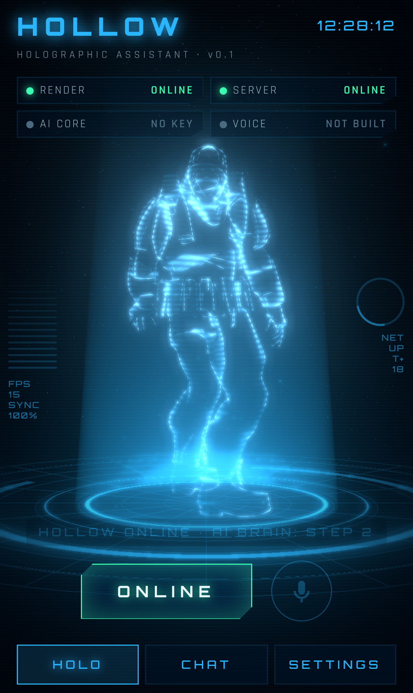

# HOLLOW

A holographic AI assistant built for the iPhone. It runs in Safari and can be added to the home screen so it opens like an app.
It is built and deployed without a Mac or PC: the code lives on GitHub, Vercel builds and hosts it, and you install it on your iPhone from Safari.



## Architecture

| Part | Technology | Where it runs |
|---|---|---|
| 3D hologram + HUD | three.js (WebGL), TypeScript, Vite | iPhone Safari / home-screen app |
| Sound effects | Web Audio API (synthesized live) | iPhone |
| Backend (`/api/*`) | Vercel serverless functions | Vercel. **API keys live only here** |
| AI brain | Claude (`claude-opus-5-5`) via `/api/chat`, streamed, with web search | Vercel → Anthropic |
| Memory | Conversation saved on the iPhone; the latest 40 messages are sent with each request | iPhone (localStorage) |
| Voice output | ElevenLabs realistic male voice via `/api/speak`; falls back to the iPhone's built-in voice | Vercel → ElevenLabs |
| Voice input | Recorded on the iPhone, auto end-of-speech detection, transcribed via `/api/transcribe`; falls back to the iPhone's speech recognition | iPhone → Vercel → ElevenLabs |

## Roadmap (one feature at a time)

- [x] **Step 1:** 3D holographic character, HUD, CONNECT boot sequence, status lights, settings, sound effects, `/api/health`
- [x] **Step 2:** AI brain: Claude via a secure server endpoint, a chat screen, conversation memory, an optional access code
- [x] **Step 3:** Voice: microphone input, a realistic male voice, hands-free back-and-forth, and a hologram that reacts to listening, thinking and speaking
- [ ] **Step 4:** Custom realistic male avatar (face, eyes, lip-sync to speech)
- [ ] **Step 5:** Polish: wake behavior, more animations, offline handling

## Honesty rules

Status lights report what is actually working. A feature that has not been built is labeled **NOT BUILT** and is never simulated.

## Server environment variables

See `.env.example`. They are set in Vercel, never in the app.

## Development (optional; not needed from the phone)

```
npm install
npm run dev     # serves the app and the /api functions locally
npm run build
```

## Credits

The placeholder character (`public/models/hollow.glb`) is the "Soldier" sample model from the three.js examples (a Mixamo character). It will be replaced by a custom realistic avatar in Step 4.
