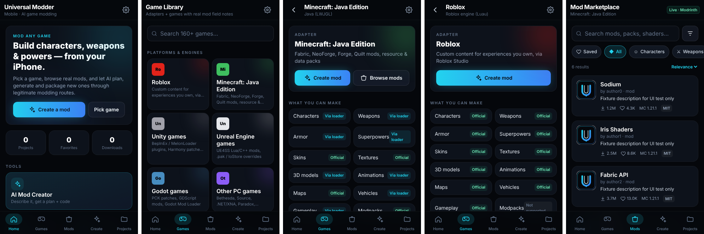

# Universal Modder Mobile

An iPhone-first AI game-modding platform, built as an installable Progressive Web App.
Inspired by and built on [rehan-remade/universal-modder](https://github.com/rehan-remade/universal-modder) (MIT).

**Live:** https://universal-modder-mobile.hell-1cf326ce.workers.dev — open in Safari → Share → **Add to Home Screen**.



## What works today (Phase 1 + early Phases 2–4, 7)

| Screen | Status | Data source |
|---|---|---|
| Home dashboard | ✅ | live status of Modrinth, backend, AI, asset keys |
| Game library | ✅ 6 adapters + 160+ games | Universal Modder knowledge base (395 field notes, MIT) |
| Mod marketplace | ✅ search, 12 categories, version/loader filters, sort, favorites | **live Modrinth API** |
| Mod details | ✅ gallery, license, versions, per-file downloads, compatibility verdict | live Modrinth API |
| Compatibility checker | ✅ version + loader + required deps + declared conflicts | live Modrinth version metadata |
| AI Mod Creator | ✅ chat, per-reply cost, save generated files to project | `/api/ai` → Claude (server-side key) |
| Asset Studio | ✅ 16×16/32×32 pixel texture editor → PNG / project | on-device; cloud generation is Phase 7 |
| Downloads | ✅ history with version, loader, license, SHA-1 | — |
| My projects | ✅ stored in IndexedDB, packaged as .zip on-device | — |
| Settings | ✅ defaults, AI spend, storage, backup/erase, credits | — |

Nothing is mocked: every mod listing comes from Modrinth at request time. Sources that are not wired up yet
(Thunderstore, CurseForge, Nexus, Roblox Creator Store) are shown as plain external links, never as fake listings.
“Compatible” always means *declared compatible by the author's published metadata*, and the UI says so.

## Architecture

```
iPhone Safari / Home-Screen PWA (React + TypeScript + Tailwind, service worker, IndexedDB)
   │  ├── api.modrinth.com  (direct, CORS)  → browse, details, versions, compatibility
   │  └── /api/*            (same origin)
   ▼
Cloudflare Worker  (app/worker)
   ├── serves the PWA (assets embedded at build time, immutable caching, CSP)
   ├── /api/health  → which integrations are configured (never returns secrets)
   └── /api/ai      → Anthropic Messages API (claude-opus-5-5) with the
                      Universal Modder "mod-any-game" loop adapted for mobile
```

- `app/src/adapters/` — **game adapter framework**: each adapter declares engine, formats, loaders, sources,
  asset requirements, install steps, compatibility rules, capabilities and hard boundaries
  (Roblox, Minecraft, Unity, Unreal, Godot, Other PC).
- `app/src/lib/modrinth.ts` / `compat.ts` — Modrinth client and metadata-based compatibility verification.
- `app/src/lib/knowledge.ts` + `src/data/knowledge.json` — trimmed index of the upstream knowledge base; each
  note links to the full write-up on GitHub.
- `app/src/lib/zip.ts` — dependency-free ZIP packaging on the phone.
- `app/worker/ai.ts` — the orchestration prompt: understand → identify game → recon → feasibility → plan →
  assets → code → validation → install, with the upstream safety rules (no anti-cheat/DRM bypass, no online
  cheating, Roblox only for experiences you own).

### What was reused from Universal Modder, and what wasn't
Reused: the 10-step modding loop, game-recon method, engine playbook facts (loaders, formats, log locations),
safety rules, and the knowledge-base index. Not reused: the `um` CLI, Windows automation, decompilers and
Blender pipelines — they need a desktop OS and cannot run in Safari. Their mobile equivalents are cloud workers
(planned) and hand-off steps the AI flags explicitly.

## Turning on AI (from your iPhone)
1. Get an API key at console.anthropic.com.
2. In Safari open dash.cloudflare.com → **Workers & Pages** → `universal-modder-mobile` → **Settings** →
   **Variables and Secrets** → **Add** → type *Secret*, name `ANTHROPIC_API_KEY`, paste the key → **Deploy**.
3. Reload the app: Home → *AI engine* turns green. Each reply shows its cost (Opus 5.5: $4 / $20 per M tokens).

## Develop
```bash
cd app
npm install
npm run dev        # UI on :5173 (proxy /api → :8788)
npm run preview    # build + run the Worker locally on :8788
npm run deploy     # build + wrangler deploy
```

## Roadmap
- **Phase 2** — Thunderstore (via Worker proxy), CurseForge/Nexus with user-provided keys.
- **Phase 3** — streaming replies, structured plans, image prompts → Asset Studio.
- **Phase 5** — Roblox: Luau project templates, Rojo layout export, Open Cloud asset upload for experiences you own.
- **Phase 6** — cloud build worker (JDK/Gradle for Fabric jars, .NET for BepInEx) so mods compile without a PC.
- **Phase 7** — fal.ai generation (sprites, seamless textures, image-to-3D, rigging), resource-pack/datapack exporters.
- **Phase 8** — accounts + cloud sync (Supabase), rate limiting, tests in CI.

### What still needs a computer
Installing into PC games (Minecraft Java, Unity/Unreal games) and placing content in Roblox Studio happen on a
Windows/macOS machine. The phone handles discovery, planning, code, assets, packaging and downloads; files move
over iCloud Drive or AirDrop.

## Credits
Universal Modder © Rehan and contributors, MIT — see `THIRD_PARTY_LICENSE-universal-modder.txt`.
Mod data and files © their authors via Modrinth, each under its own license. Not affiliated with Mojang,
Microsoft or Roblox Corporation.
